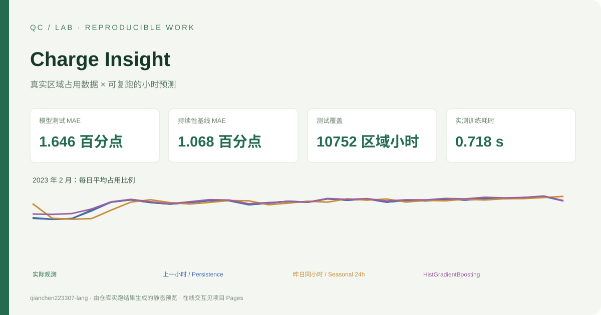

# Charge Insight



[在线交互演示](https://qianchen223307-lang.github.io/charge-insight/) · [实验与样例结果](results/) · [验证流程](.github/workflows/ci.yml)


**用真实 UrbanEV 区域观测，做口径清晰、能复跑的下一小时充电占用预测。**

[交互展示](https://qianchen223307-lang.github.io/charge-insight/) · [English](README.en.md) · [数据与来源](SOURCES.md) · [AI 使用说明](AI_USE.md)

这个项目独立实现了数据来源校验、区域容量聚合、过去特征构建与 CPU 预测评估。它展示数据工程与机器学习实验能力；不是 UrbanEV 原论文模型的复现，也不把占用情况称为实测电功率。

## 一命令复跑

Python 3.12 环境安装依赖后，在本仓库目录运行：

```bash
python -m pip install -e .
python -m charge_insight demo
```

`demo` 直接使用已附带的约 264 KB 固定子集，不需要账号、API Key 或再次联网。它重新训练 16 个模型，生成 `results/predictions.csv`、`metrics.csv`、`run.json`、`summary.json` 和 `docs/data.json`。时间是当前机器的实测值，重新运行会变化。

可选：重新下载作者固定提交，校验 Git blob 哈希并再生成相同子集：

```bash
python -m charge_insight download
python -m unittest discover -s tests -v
```

## 数据口径和独立改进

作者仓库固定提交 `44f2aa0c8d89f192bce00bafb0def74a21b39c68`；6 个月、4,344 小时。固定选择原始列序前 16 个区域，不按预测成绩挑选。文件哈希和完整来源见 `data/provenance.json`。

上游 README 标注占用率百分比，但 CSV 实际存储原始占用数量。作者代码也通过桩数归一化。本项目把 `inf.csv` 的同区多个站点 **先按 TAZID 求和**，再将原始占用数除以区域容量；避免 `dict(zip(...))` 覆盖同区站点。全量源数据的占用数均不超过区域聚合容量。

## 实验约定

| 项目 | 固定设置 |
|---|---|
| 预测目标 | 下一小时区域占用比例；误差以百分点报告 |
| 训练 | 2022 年 9–12 月，前 168 小时仅作历史上下文；每区 2,760 个目标样本 |
| 验证 | 2023 年 1 月，共 744 小时；只用于诊断 |
| 测试 | 2023 年 2 月，共 672 小时、10,752 个区域小时 |
| 特征 | 滞后 1/2/3/24/48/168 小时、过去滚动均值、目标时间的已知日历 |
| 基线 | 上一小时持续性、昨日同小时 |
| 模型 | 固定参数 HistGradientBoosting，单线程、随机种子 2026 |

每个预测只使用该目标小时之前已观测的数据。测试按滚动一步预测执行，2 月较早的真实观测可以用于预测其后的小时，不等于一次性预测整月。模型参数不根据测试集选择，训练和测试结果均完整导出。

## 实际运行结果

| 方法 | 2 月测试 MAE（百分点） | RMSE（百分点） |
|---|---:|---:|
| 上一小时持续性 | 1.0682 | 2.3570 |
| 昨日同小时 | 3.6312 | 5.5084 |
| HistGradientBoosting | 1.6461 | 2.6402 |

**本次固定留出上，简单持续性基线优于提升树模型。** 项目保留这一结果，不将加入模型包装成性能改进。误差改善需要另外设计并预先锁定实验，不能回头按测试集改参数。16 个区域模型总 fit 耗时以 `results/run.json` 为准。

## 业务验证

测试覆盖同区站点容量累加、目标与未来观测不进入特征、日历边界切分、固定数据哈希和容量边界。数值结果以实际命令生成的 `results/` 为准。

## 边界

作者已对原始数据做异常处理及前后填充，缺失掩码无法恢复，因此这不是原始实时数据流上的部署验证。结果只对应固定 16 区域与一个时间留出；没有证明跨城市泛化。没有使用额定功率推算的 `volume.csv`，没有宣称实测节电、碳减排或已接入运营系统。

代码为 MIT；UrbanEV 数据保留 CC0 授权。数据作者、独立工程贡献及 AI 辅助边界见 [SOURCES.md](SOURCES.md) 和 [AI_USE.md](AI_USE.md)。

## 固定环境与验证

使用 Python 3.12。锁文件包含开发、构建及跨平台运行依赖，首次安装后即可复跑：

```bash
python -m venv .venv
# Windows: .venv\Scripts\activate
# macOS / Linux: source .venv/bin/activate
python -m pip install -r requirements.lock
python -m pip install --no-build-isolation --no-deps -e .
python -m pytest -q
python -m charge_insight demo
```

Pages 目录为 `docs/`，包含可直接打开的独立 HTML。交互展示读取已计算结果；完整计算在本地 Python 运行。构建时的来源、数据类型和实验局限见本文及来源文档。

更新演示数据后，执行 `python scripts/build_site.py` 重建独立网页。静态结果预览对应本仓库已记录的完整实验；重新计时会因机器与系统负载不同而变化。
